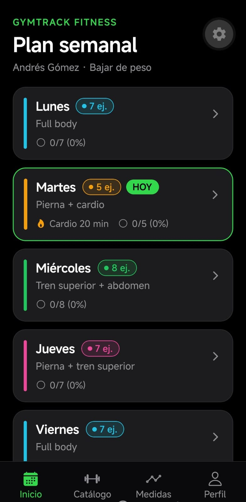
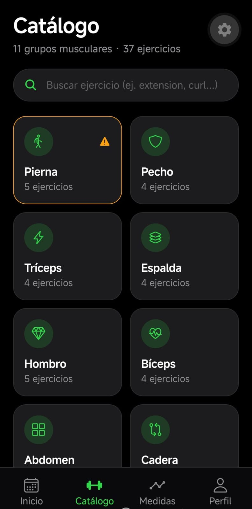
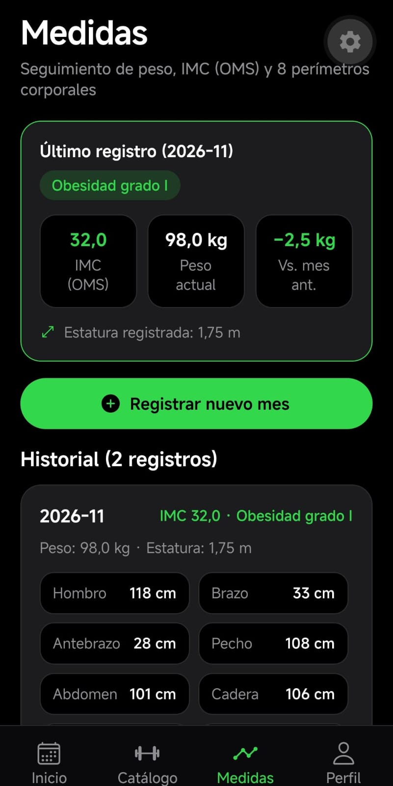
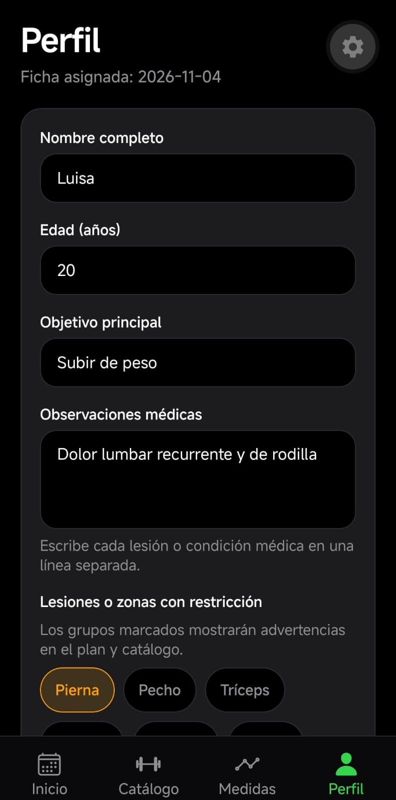

# GymTrack

Aplicación móvil desarrollada en **React Native + Expo Router + TypeScript (modo estricto)** que digitaliza la ficha de entrenamiento de un gimnasio: plan semanal de lunes a sábado con código de color, registro de progreso por sesión, catálogo de 37 ejercicios en 11 grupos musculares con búsqueda sin tildes, perfil editable del socio y seguimiento mensual de medidas corporales con cálculo de IMC (OMS).

## Integrantes

- Integrante 1: `[Juan camilo Jiménez Díaz - 407271]`
- Integrante 2: `[Luisa Gironza - 408993]`

**Curso:** Desarrollo de Aplicaciones Móviles, VI semestre, Ingeniería de Sistemas, 2026-2.

## Entorno tecnológico

| Herramienta | Versión | Verificación |
| --- | --- | --- |
| Node.js | 24 LTS (`v24.20.0`) | `node -v` |
| Expo SDK | `~57.0.34` (SDK 57 fijado) | `package.json` |
| Expo Router | `~57.0.32` | Carpeta raíz `app/` |
| TypeScript | `~6.0.3` (`strict: true`) | `npx tsc --noEmit` |
| Persistencia (RF11) | `@react-native-async-storage/async-storage` `2.2.0` | `context/GymContext.tsx` |

## Instrucciones de ejecución

1. Clonar el repositorio e ingresar al proyecto:
   ```bash
   cd gymtrack
   npm install
   ```
2. Iniciar el servidor de desarrollo de Expo:
   ```bash
   npx expo start
   ```
3. Escanear el código QR con **Expo Go compatible con SDK 57** (Android o iOS).
4. Verificación de tipos y linter:
   ```bash
   npx tsc --noEmit
   npx expo lint
   ```

## Video demostrativo

- Enlace al video: `[https://drive.google.com/file/d/1xwY6x_uT6vGipiyn_g-EiiGxcLrjaWcY/view?usp=sharing]`

## Tabla de requisitos

### Requisitos funcionales (obligatorios y bonificaciones)

| ID | Requisito | Tipo | Estado | Evidencia en el proyecto |
| --- | --- | --- | --- | --- |
| RF01 | Ver el plan semanal (6 días, color oficial, día actual destacado y descanso el domingo) | Obligatorio | Cumplido | `app/(tabs)/index.tsx`, `components/TarjetaDia.tsx`, `data/plan.ts` |
| RF02 | Ver el detalle de un día (`/dia/[dia]`, calentamiento 5 min, grupos musculares 4 × 12, cardio y cierre 10 min) | Obligatorio | Cumplido | `app/dia/[dia].tsx`, `components/BloqueActividad.tsx` |
| RF03 | Consultar el catálogo (11 grupos musculares y listado por grupo en `/grupo/[grupo]`) | Obligatorio | Cumplido | `app/(tabs)/catalogo.tsx`, `app/grupo/[grupo].tsx`, `components/TarjetaGrupo.tsx` |
| RF04 | Filtrar ejercicios por nombre sin distinguir mayúsculas ni tildes | Obligatorio | Cumplido | `app/(tabs)/catalogo.tsx`, `utils/texto.ts` |
| RF05 | Ver el detalle de un ejercicio (`/ejercicio/[id]` con imagen o marcador, 4 × 12 y días asignados) | Obligatorio | Cumplido | `app/ejercicio/[id].tsx`, `components/DetalleEjercicioCard.tsx` |
| RF06 | Registrar la sesión del día con barra de progreso (`completados / total` y porcentaje) | Obligatorio | Cumplido | `app/dia/[dia].tsx`, `components/ItemEjercicio.tsx`, `components/BarraProgreso.tsx` |
| RF07 | Gestionar el perfil con formulario controlado, validación (nombre no vacío, edad entera 14–90) y alerta | Obligatorio | Cumplido | `app/(tabs)/perfil.tsx`, `components/FormularioPerfil.tsx`, `components/CampoFormulario.tsx` |
| RF08 | Registrar medidas mensuales (mes sin duplicados, estatura 1,00–2,30 m, peso 30–300 kg, 8 perímetros, IMC OMS e historial) | Obligatorio | Cumplido | `app/(tabs)/medidas.tsx`, `components/ResumenMedida.tsx`, `components/FormularioMedida.tsx`, `utils/imc.ts` |
| RF09 | Advertir restricciones cuando `socio.lesiones` coincide con el grupo muscular | Bonificación | Cumplido | `components/AlertaLesion.tsx`, `components/SelectorLesiones.tsx`, `components/ItemEjercicio.tsx` |
| RF10 | Temporizador de descanso de 60 s con `useEffect`, `setInterval` y `clearInterval` al desmontar | Bonificación | Cumplido | `components/TemporizadorDescanso.tsx`, `app/dia/[dia].tsx`, `app/ejercicio/[id].tsx` |
| RF11 | Persistir perfil, sesiones completadas y medidas con `AsyncStorage` | Bonificación | Cumplido | `context/GymContext.tsx` |

### Requisitos no funcionales

| ID | Criterio | Estado |
| --- | --- | --- |
| RNF01 | TypeScript `strict: true`, sin `any` ni `@ts-ignore`, `npx tsc --noEmit` sin errores | Cumplido |
| RNF02 | Compatible con Expo Go SDK 57, sin librerías de UI externas | Cumplido |
| RNF03 | Objetivos táctiles ≥ 44 × 44 pt, texto ≥ 14 pt, `SafeAreaView` y cuadrícula adaptable (> 600 pt) | Cumplido |
| RNF04 | Estructura de carpetas respetada y todas las pantallas en `app/` ≤ 200 líneas | Cumplido |
| RNF05 | Historial Git con ≥ 8 commits descriptivos, `.gitignore` sin `node_modules` y tag `v1.0` | Cumplido |
| RNF06 | Navegación fluida en memoria local sin llamadas externas | Cumplido |

## Bonificaciones implementadas

- **RF09 – Alertas por lesión:** Los grupos registrados en `socio.lesiones` (inicialmente `pierna` y `lumbar`, editables desde Perfil con `SelectorLesiones`) resaltan las tarjetas del catálogo, agregan aviso en cada `ItemEjercicio` y muestran el banner `AlertaLesion` con las observaciones médicas del socio en el detalle del grupo y del ejercicio.
- **RF10 – Temporizador de descanso de 60 s:** Disponible en el detalle del día (`/dia/[dia]`) y del ejercicio (`/ejercicio/[id]`). Permite iniciar, pausar y reiniciar una cuenta regresiva de 60 segundos; el intervalo se limpia siempre en la función de retorno de `useEffect` (`clearInterval`) al pausar o desmontar la pantalla.
- **RF11 – Persistencia con AsyncStorage:** `GymContext` hidrata al inicio los datos guardados bajo las claves `@gymtrack/socio`, `@gymtrack/medidas` y `@gymtrack/completados` usando guardas de tipo estrictas (`unknown`), y guarda automáticamente cada cambio tras completar la carga inicial.


## Capturas de pantalla

| 1. Inicio (Plan semanal) | 2. Catálogo y búsqueda |
| :---: | :---: |
|  |  |

| 3. Medidas e IMC | 4. Perfil del socio |
| :---: | :---: |
|  |  |

## Bitácora de investigación autónoma (T1 a T8)

| Tema | Fuentes consultadas | Qué se aprendió | Archivo donde se aplicó |
| --- | --- | --- | --- |
| **T1. Estado global con Context** | [React: useContext](https://react.dev/reference/react/useContext), [Passing Data Deeply with Context](https://react.dev/learn/passing-data-deeply-with-context) | Context evita pasar props manualmente por varios niveles (*prop drilling*) cuando múltiples pestañas y rutas leen el mismo socio, medidas y ejercicios completados. El hook `useGym()` lanza un error si el contexto es `null` para fallar de inmediato y garantizar a TypeScript un valor no nulo dentro de `GymProvider`. | `context/GymContext.tsx`, `app/_layout.tsx` |
| **T2. Tabs y rutas dinámicas en Expo Router** | [Expo Router: Introduction](https://docs.expo.dev/router/introduction/), [Tabs](https://docs.expo.dev/router/advanced/tabs/), [Dynamic Routes](https://docs.expo.dev/router/create-pages/#dynamic-routes) | El grupo `app/(tabs)/` agrupa las pestañas sin añadir segmento a la URL, mientras que `app/dia/[dia].tsx` se mapea a `/dia/:dia` y recibe el valor mediante `useLocalSearchParams`. Usar `<Stack.Screen options={{ title }} />` permite asignar títulos dinámicos y validar el parámetro antes de renderizar. | `app/_layout.tsx`, `app/(tabs)/_layout.tsx`, `app/dia/[dia].tsx`, `app/grupo/[grupo].tsx`, `app/ejercicio/[id].tsx` |
| **T3. useEffect y limpieza** | [React: Synchronizing with Effects](https://react.dev/learn/synchronizing-with-effects), [useEffect](https://react.dev/reference/react/useEffect) | La función de limpieza devuelta por `useEffect` se ejecuta al cambiar dependencias o desmontar el componente. Si el temporizador no llamara a `clearInterval`, el intervalo seguiría activo en memoria intentando actualizar estado en un componente desmontado y degradando el rendimiento. | `components/TemporizadorDescanso.tsx`, `context/GymContext.tsx` |
| **T4. Formularios controlados y validación** | [React Native: TextInput](https://reactnative.dev/docs/textinput), [KeyboardAvoidingView](https://reactnative.dev/docs/keyboardavoidingview) | Los campos controlados mantienen la fuente de verdad en `useState` y permiten validar antes de persistir. Como `Number('')` devuelve `0` (y no `NaN`), validar cadenas vacías y expresiones regulares (`/^\d+$/`) antes de convertir a número evita aceptar entradas vacías o decimales en la edad. | `components/CampoFormulario.tsx`, `components/FormularioPerfil.tsx`, `components/FormularioMedida.tsx` |
| **T5. Diseño adaptable** | [React Native: Flexbox](https://reactnative.dev/docs/flexbox), [useWindowDimensions](https://reactnative.dev/docs/usewindowdimensions), [SafeAreaContext](https://docs.expo.dev/versions/latest/sdk/safe-area-context/) | `SafeAreaView` protege la interfaz frente a muescas, barras de estado e indicadores gestuales en vertical y horizontal. Con `useWindowDimensions().width`, la cuadrícula con `flexWrap` cambia dinámicamente de 2 columnas (`50%`) a 3 columnas (`33.33%`) cuando el ancho supera los 600 puntos. | `app/(tabs)/catalogo.tsx`, `app/(tabs)/index.tsx`, `constants/estilos.ts` |
| **T6. Arreglos y tipos en TypeScript** | [TypeScript Handbook: Narrowing](https://www.typescriptlang.org/docs/handbook/2/narrowing.html), [MDN: String.prototype.normalize](https://developer.mozilla.org/es/docs/Web/JavaScript/Reference/Global_Objects/String/normalize) | Con tipos unión (`DiaSemana`, `GrupoMuscular`) y guardas de tipo (`valor is DiaSemana`), se estrechan parámetros de ruta sin usar `any`. `PLAN_SEMANAL.filter(...)` obtiene los días de un ejercicio, y `normalize('NFD')` separa los acentos diacríticos para eliminarlos con regex y encontrar “Extensión” al buscar “extension”. | `types/gym.ts`, `utils/texto.ts`, `data/plan.ts`, `app/ejercicio/[id].tsx` |
| **T7. Imágenes locales** | [React Native: Images](https://reactnative.dev/docs/images), [Expo Image](https://docs.expo.dev/versions/latest/sdk/image/) | Metro resuelve los recursos estáticos en tiempo de empaquetado, por lo que `require(...)` exige rutas literales conocidas estáticamente y no puede concatenar variables dinámicas. Cuando `ejercicio.imagen` es `undefined`, se renderiza un marcador visual consistente con el código del ejercicio. | `types/gym.ts`, `components/DetalleEjercicioCard.tsx`, `assets/images/ejercicios/` |
| **T8. Persistencia con AsyncStorage** | [Expo: AsyncStorage](https://docs.expo.dev/versions/latest/sdk/async-storage/) | `AsyncStorage` guarda pares clave-valor en texto plano (`JSON.stringify` / `JSON.parse`) de forma asíncrona, ideal para preferencias y registros locales de entrenamiento. No debe usarse para contraseñas ni tokens porque el almacenamiento no está cifrado (para secretos se requiere `expo-secure-store`). | `context/GymContext.tsx` |

## Reflexión técnica

**Decisión de diseño:** Se optó por una estética iOS / Apple Fitness+ en negro OLED (`#000000` de fondo, tarjetas `#1C1C1E` con borde `#2C2C2E` y acento verde neón `#32D74B`) conservando los colores oficiales de cada día como insignias e indicadores, junto con animaciones nativas (`Animated`), vibración háptica (`expo-haptics`) y componentes tipados en `components/`. Esta arquitectura mantuvo todas las pantallas de `app/` por debajo de las 200 líneas (máximo 190 en `dia/[dia].tsx`), facilitó reutilizar `BotonAnimado`, `EntradaAnimada` e `ItemEjercicio`, y aseguró toques ≥ 44 × 44 pt y texto ≥ 14 pt.

**Dificultad y resolución:** Al inicializar la plantilla oficial de Expo SDK 57, el proyecto ubicaba las rutas en `src/app/` y omitía `@expo/vector-icons`, además de activar las reglas estrictas de React 19 en `expo lint`, que marcaron un error `react-hooks/set-state-in-effect` al sincronizar el formulario de perfil dentro de un `useEffect`. Para resolverlo, se reubicó la carpeta de rutas en `app/` en la raíz ajustando el alias `@/*` en `tsconfig.json`, se instalaron los paquetes permitidos mediante `npx expo install` para fijar versiones compatibles con SDK 57 y se refactorizó el formulario en `FormularioPerfil` reiniciándolo mediante `key` declarativa en lugar de mutar estado sincrónicamente en un efecto.

**Uso de IA declarado:** Se utilizó el asistente de IA **Antigravity (Google DeepMind)** como apoyo para estructurar el proyecto por fases, redactar componentes tipados en TypeScript estricto, validar el cumplimiento de la rúbrica, depurar reglas de ESLint de React 19 y documentar la bitácora técnica. Todo el código fue revisado, compilado con `npx tsc --noEmit`, verificado con `npx expo lint` y probado mediante empaquetado Metro para garantizar comprensión completa para la sustentación individual.
